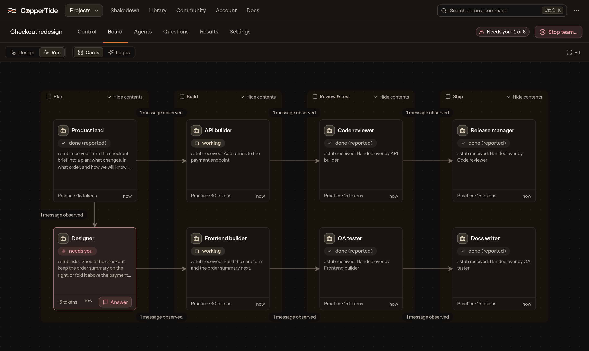
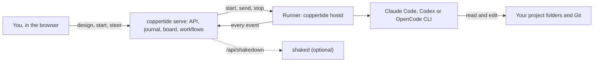

<p align="center"></p>

<p align="center">
  <a href="LICENSE"></a>
  <a href="https://docs.coppertide.ai"></a>
</p>

# CopperTide

CopperTide is the app for running teams of coding agents on your own computer. You give each agent a job and a folder, connect who hands work to whom, and follow the team on one board. Open any agent to read its conversation, answer its questions or send it guidance. Agents run through your installed [Claude Code](https://docs.anthropic.com/en/docs/claude-code), [Codex](https://github.com/openai/codex) or [OpenCode](https://opencode.ai) CLI, with your own sign-in. It is for developers and researchers who run several agents on one project and need to see who owns each task and what actually happened.

The same app holds the pages for [Shakedown](https://github.com/CopperTide/Shakedown), CopperTide's product for testing agent systems against simulated worlds, when a local `shaked` is running. This repository also holds the sources of [docs.coppertide.ai](https://docs.coppertide.ai), the Shakedown user guide.



## What you get

- **A shared board.** Arrange agents in groups, draw handoffs and follow progress live. A project opens on Control, a dockable workspace with the board, status, timeline, alarms and approvals.
- **Honest status.** Planned, in progress, reported complete, verified and blocked stay distinct. An agent saying "done" is labelled as a report, not as proof.
- **Local execution.** Agents work in the folders you allow, with your CLIs and your plan. Local data, including run history, lives in `~/.coppertide/`.
- **Usage limits.** Run budgets, token limits per agent, capped shell output and fresh conversations once an agent's context grows large.
- **Workflows when you need them.** Stages, review panels, checks, merges, schedules and a decision log stay under Advanced.
- **Portable teams.** Import and export teams as [MADL](https://github.com/CopperTide/Multi-Agent-Descriptor-Language) files, or run one from the terminal with `coppertide run`.

## Quick start

You need Rust (CI and the hosted image build with 1.98), [Node.js](https://nodejs.org/) 24 and Git. To run real agents, install Claude Code, Codex or OpenCode and sign in first.

```bash
git clone https://github.com/CopperTide/CopperTide.git
cd CopperTide
npm --prefix web ci
npm --prefix web run build
cargo run --release -p coppertide -- serve
```

Open http://127.0.0.1:4410 and choose **New project**. Pick a starting team such as **Builder → Reviewer**, choose a project folder and write each agent's **Job**. When the CLIs show as ready, choose **Start team** and confirm. Agents use your provider account and cost money or plan usage.

`coppertide serve` takes `--port` (default `4410`), `--data-dir` (or `COPPERTIDE_DATA_DIR`, default `~/.coppertide`) and `--web-dir` (default `web/dist`). Run `cargo run -p coppertide -- --help` for every command.

### Shakedown pages

To use the Shakedown pages locally, start `shaked` from a [Shakedown](https://github.com/CopperTide/Shakedown) checkout (`cd core && cargo run -p shaked`). CopperTide forwards `/api/shakedown/*` to it at `http://127.0.0.1:4510`. Set `COPPERTIDE_SHAKEDOWN_URL` to use another address. The Shakedown repository's own UI and the [self-host guide](https://docs.coppertide.ai/self-host) are the main way to run Shakedown locally.

## How it works



`coppertide serve` keeps every captured event in an append-only journal and builds the app's views from it. It starts the runner, which starts each CLI, captures its output and delivers messages. A runner on another computer connects with `coppertide connect`. The [internals overview](docs/internals/overview.md) has the full picture.

## What's in this repo

| Path | Job |
|---|---|
| `crates/coppertide` | The `coppertide` binary: `serve`, `hostd`, `connect`, `run`, `doctor` and more |
| `crates/controld` | The server: HTTP API, event journal, teams, workflows, the Shakedown pass-through |
| `crates/hostd`, `crates/drivers` | The runner and the Claude Code, Codex and OpenCode drivers |
| `crates/host-proto`, `crates/signing` | The server-runner protocol and request signing shared with the hosted gateway |
| `crates/localops` | Folders, Git, agents' working copies, checks |
| `crates/model`, `crates/rigspec` | Shared types, and the team design format with its validation, compiler and templates |
| `crates/interpreter` | Reads each tool call and says, as a heuristic, what it did |
| `crates/fixtures`, `crates/e2e-server` | Fake CLIs for tests and the Playwright web server |
| `web/` | The React and TypeScript app |
| `desktop/` | The Electron desktop app ([README](desktop/README.md)) |
| `docs-site/` | The sources of docs.coppertide.ai ([README](docs-site/README.md)) |
| `docs/` | Contributor docs: [internals](docs/internals/README.md), the [Control guide](docs/guide/control.md), showcases, images and videos |
| `examples/` | [Example teams](examples/teams/README.md), Community seed teams and the textbook kit |
| `deploy/` | The runner install scripts and release packaging |

## How it fits

| Repository | What it holds |
|---|---|
| [Shakedown](https://github.com/CopperTide/Shakedown) | The open-source Shakedown engine: the `shaked` service, the `shakedown` Python SDK, integrations and benchmarks |
| **CopperTide** (this repository) | **The open-source CopperTide app (the `coppertide` binary, web app and desktop app) and the sources of docs.coppertide.ai** |
| CopperTide-Cloud (private) | The hosted service at app.coppertide.ai: the gateway, accounts, orgs, sign-in and hosted Shakedown |
| CopperTide-Community (private) | The Community server: published agent groups and components, profiles and moderation |

The user guide is at [docs.coppertide.ai](https://docs.coppertide.ai). Hosted Shakedown is at [app.coppertide.ai/sd/](https://app.coppertide.ai/sd/): sign in with Google or GitHub.

## Development

```bash
cargo fmt --all -- --check
cargo clippy --workspace --all-targets
cargo test --workspace
npm --prefix web test
npm --prefix web run lint
npm --prefix web run e2e          # Playwright, against the real binary with Practice agents
```

Tests never call a real model. They use the fake CLIs in `crates/fixtures` and Practice agents. TypeScript API types in `web/src/generated/` come from Rust: regenerate them with `cargo test --workspace export_bindings`. [Testing](docs/internals/testing.md) lists every suite.

## Contributing, security and license

- Read [CONTRIBUTING.md](CONTRIBUTING.md) to set up and run the checks, and follow the [Code of Conduct](CODE_OF_CONDUCT.md).
- Report security problems privately, as [SECURITY.md](SECURITY.md) describes.
- CopperTide is licensed under the [Apache License 2.0](LICENSE).
