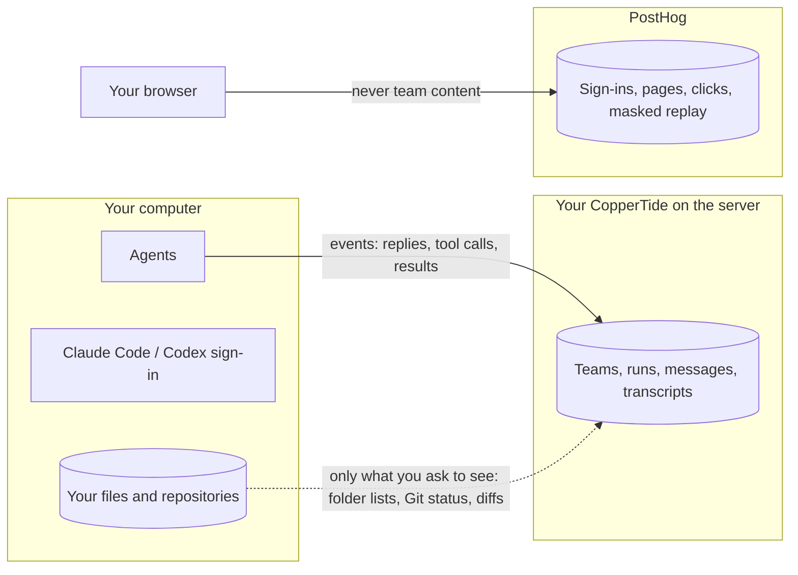

CopperTide stores team designs and run history so you can run agents and review their work. In the hosted beta, that operational data is stored in your account's CopperTide instance. In local mode, it is stored on your computer.

The hosted beta also collects **usage analytics** with [PostHog](https://posthog.com): how people sign in and which pages and features they use. Analytics never include what you type, or the content of your teams, prompts or runs. Self-hosted CopperTide does not collect usage analytics.

<Check>The same summary is in the app: open **What we record** from your account.</Check>

## What PostHog receives

PostHog Inc. (United States) processes usage analytics for us, on PostHog's US Cloud. It receives:

| What | From | Details |
| --- | --- | --- |
| Who you are | The CopperTide site and your browser | Your account id, email and name, and your organization's id (a personal organization is named only "Personal"), so events from one person and one organization can be counted together |
| What any website sees | Your browser | Your browser, operating system, device type, screen size and IP address. PostHog is set to discard IP addresses (its "Discard client IP data" setting), and the CopperTide site's own events ask it not to look them up (`$geoip_disable`) |
| Account events | The CopperTide site | `user signed up` and `user signed in`, each with the method (password, Google or GitHub); `org created`; `invite accepted` |
| Pages and clicks | Your browser, while signed in, in CopperTide and in hosted Shakedown | The pages you open, with names in addresses replaced (for example `/team/:id/structure` or `/sd/worlds/:id`), and the buttons you click, with their text masked |
| Named actions | Your browser, while signed in | A few actions by name only. In CopperTide: Describe it opened, team file exported or imported, run imported or downloaded, question answered, Community block added. In hosted Shakedown: project, world, scenario, setup or experiment created; run or experiment run started; experiment deployed; fork made; compare opened |
| Session replay | Your browser, while signed in, outside Europe | The page's layout and your clicks and scrolling, with **all text and every input masked** and names removed from page addresses. Network requests are not recorded |

PostHog keeps this data under its own retention settings for our project.

## Never sent to PostHog

- What you type, in any field
- Prompts, messages and jobs
- Agent output and transcripts
- Team names and agent names
- Folder names and paths
- File contents
- Check commands and their output
- Passwords, keys and tokens

## Opting out

- **Do Not Track or Global Privacy Control:** turn either on in your browser, and nothing is sent to PostHog: not from your browser, and not about your sign-ups and sign-ins from the CopperTide site.
- **In Europe:** if your browser's time zone is in the EU or EEA, its outermost regions included, PostHog stores nothing in your browser (no cookie, no local storage) and records no session replay. Page views, clicks and named actions still reach PostHog while the page is open, unless Do Not Track or Global Privacy Control is on.
- **Run it yourself:** self-hosted CopperTide sends nothing. See [Run it yourself](/operations).

## Data stored to run your teams

Analytics are separate from the data CopperTide needs to run your teams. With an account:

| Data | Where | Why |
| --- | --- | --- |
| Your teams' designs, including jobs | Your own CopperTide on the server | To show and run your teams. |
| Messages, agent replies, tool calls and results, questions and answers | Your own CopperTide on the server | So you can watch a run, inspect its evidence and come back to its history. |
| Your files and repositories | On your computer | Agents work there. Requested folder listings, Git status and diffs can reach the server. File content may also appear in captured tool results and agent replies. |
| Claude Code and Codex sign-in | Only on your computer | CopperTide never reads or stores them. |
| Your name, email, sign-in methods, and a password hash if you use a password | The account database | To sign you in. |
| Your computers: name, operating system, last seen | The account database | For the Computers page. |
| Account security events: sign-ins and failed sign-ins (method and reason), sign-up, linked sign-in methods, invites, ended sessions, computers connected and disconnected, and each change you make through the app, as its kind of request (for example POST), its address with names replaced (in CopperTide the API route, such as `/api/teams/:id/start`; in hosted Shakedown only its area, such as `/sd/api/runs/:id/:id`) and its result code, never its content, at most 600 an hour | The account database, kept 13 months | To investigate misuse of an account. |

The server's data is backed up every night. Admins can see account details and computers, and the usage analytics in PostHog. They cannot open your teams, runs or files.

## What your agents send

Claude Code and Codex send your agents' prompts and the files they read to Anthropic or OpenAI, as they do when you use them directly. That traffic goes from your computer to the provider, under your own Claude or ChatGPT plan or API key. CopperTide is not a party to it.

## Traces you choose to send

If you turn on [Send traces](/guides/send-traces) for a team, its runs go to the address you chose. By default that is timings, token counts and costs, with names: the team's, its agents', the computer's id, the models and the tools used, and the reasons for budget changes and suspected stalls. Only if you choose **Also prompts and outputs** do texts go too (each cut to 4 KB): prompts, agents' replies, and tool inputs and outputs, which can include file contents and command output. The API key you give is kept on the server and sent only to that address.

## Community

Community uses your CopperTide account. Publishing a block makes its definition public: its agents' roles and jobs, its connections, and the title and license you choose. Machine-specific folders, model overrides and workflow input are removed first, but review the jobs for private details before you publish.

Your profile is public too: your name, handle, bio, links, picture, when you joined, your published blocks and their counts. Empty fields are not shown. Reports can be about a block or a profile. See [Community](/guides/community#your-profile).

## Your choices

- **Run it yourself** to keep everything on one computer with no analytics. See [Run it yourself](/operations).
- **Export** a team as a file at any time. See [Team files](/guides/team-files).
- **Disconnect** a computer from the Computers page. Its key stops working at once.

## Next steps

<CardGroup cols={2}>
  <Card title="Security" icon="lock" href="/security">What the server can and cannot do on your computer.</Card>
  <Card title="Connect a computer" icon="plug" href="/connect-a-computer">Choose which folders agents may use.</Card>
  <Card title="Run it yourself" icon="server" href="/operations">Local storage, no usage analytics.</Card>
  <Card title="FAQ" icon="circle-question" href="/faq">Common questions.</Card>
</CardGroup>
